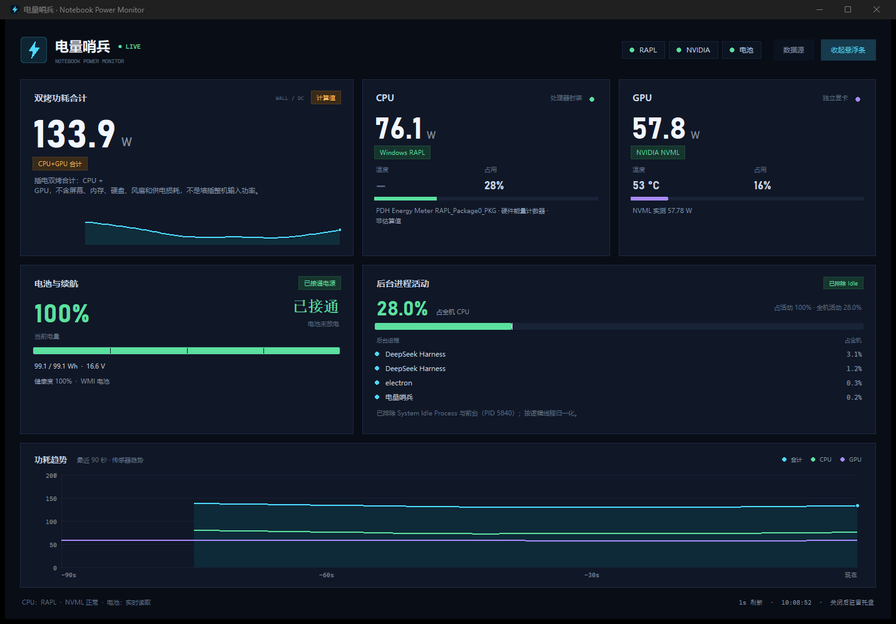

# Notebook Power Monitor

**English** | [简体中文](README.zh-CN.md)

[](https://github.com/oucdc/Power-Sentinel/actions/workflows/ci.yml)
[](https://www.microsoft.com/windows)
[](https://www.python.org/)
[](LICENSE)

A native Windows tray app for monitoring laptop power, battery runtime and background CPU activity. The UI is in Simplified Chinese; the product name is **电量哨兵** (“Power Sentinel”).

CPU power comes from Windows RAPL, GPU power and temperature from NVIDIA NVML, and battery data from WMI/ACPI. On battery, total power is the measured battery discharge. On AC, the total card shows the explicit **CPU+GPU dual-load sum**, labelled as a calculated value—not as wall input power.



## Features

- **CPU power** from Windows RAPL `Energy Meter(RAPL_Package0_PKG)`.
- **GPU power, temperature and utilisation** from NVIDIA NVML (the same source NVIDIA App uses).
- **Total power**: measured battery discharge on DC; CPU+GPU dual-load sum on AC, clearly marked as a calculated value.
- **Battery runtime** from current remaining Wh and measured discharge power, not a percentage-only estimate.
- **Background process activity** with `System Idle Process` and the foreground process excluded; every process is capped at 100%.
- **Main window, always-on-top floating bar and system tray**.
- **90-second power trend chart**, source health pills and copyable diagnostics.
- **Hybrid graphics / MUX aware**: when the dGPU sleeps or is powered off, GPU values are shown as unavailable rather than stale numbers. CPU, battery and process data keep working.
- **Single instance**: launching the app again restores the existing window.
- **No network access, no telemetry, no bundled third-party monitoring tool.**

## Download

Download the latest `电量哨兵-vX.Y.Z.zip` from the GitHub Releases page, extract it, and double-click `电量哨兵.exe`.

> Keep the `_internal` directory next to the executable. Do not copy the EXE alone.

## Run from source

Requirements: Windows 10/11, Python 3.10+ (64-bit), NVIDIA driver for GPU data. Clone or download
the repository, then run from its root:

```powershell
git clone https://github.com/oucdc/Power-Sentinel.git
cd Power-Sentinel
py -3 -m venv .venv
.\.venv\Scripts\Activate.ps1
python -m pip install -e ".[dev]"
python -m notebook_power_monitor
```

The installed GUI command is:

```powershell
notebook-power-monitor
```

### Build a Windows release

```powershell
Set-ExecutionPolicy -Scope Process Bypass
.\scripts\build.ps1
python .\scripts\package_release.py
```

The onedir build is written to `dist\电量哨兵\`, and the release ZIP to `release\`. See [docs/releasing.md](docs/releasing.md).

## Data sources

| Metric | Source | When unavailable |
|---|---|---|
| CPU power | Windows RAPL / PDH energy counter | Card shows **Unavailable** with the reason |
| GPU power / temperature | NVIDIA NVML | Whole GPU card is unavailable while the dGPU sleeps |
| Total power | AC: CPU+GPU dual-load sum (calculated); DC: measured battery discharge | **Unavailable** if a component power is missing and no Power Meter reading exists |
| CPU temperature | No trustworthy native source | `—` |
| GPU temperature | NVIDIA NVML | `—` |
| Battery | WMI `root\wmi:BatteryStatus` + ACPI battery info | Percentage only; no fabricated power |
| Background CPU | `GetSystemTimes` / `GetProcessTimes` | Activity unavailable, no invented values |

### How total power is calculated

**On battery**, the total is the **measured battery discharge** (DC-side), preserving the original behaviour.

**On AC**, the total is `CPU power + GPU power`, shown as **双烤功耗合计** and tagged **计算值** in the UI. This is a dual-load component sum: it excludes the display, memory, SSD, fans, VRMs and conversion losses, so it is not wall input power and should not be compared directly with a mains power meter.

If either CPU or GPU power is unavailable on AC, the app falls back to a real Windows Power Meter reading if one exists; otherwise the total is explicitly unavailable.

CPU temperature is intentionally absent. Windows does not expose a reliable package temperature through a native API, and the project does not want to display a plausible-looking but wrong value.

### Hybrid graphics / MUX

NVML is the liveness gate for GPU data. If NVML errors, reports zero, or has not produced a sample for 3.5 seconds, the GPU card becomes unavailable. CPU RAPL and battery WMI are independent of the GPU state, so switching MUX mode or letting the dGPU sleep does not break CPU or battery readings.

## Privacy

- No network requests, telemetry or analytics.
- Logs and configuration are stored under `%APPDATA%\NotebookPowerMonitor\` (or a writable fallback directory).
- Diagnostics are copied to the clipboard only when the user clicks **Copy diagnostics**.
- Issue reports may contain machine names and paths; redact them before posting.

## Project layout

```text
notebook_power_monitor/   Application package
  assets/                 Runtime icon assets
  battery.py              WMI / ACPI battery reader
  collector.py            Native source merging and runtime estimation
  gpu.py                  NVML sampler and sleep gate
  processes.py            Win32 process accounting
  rapl.py                 RAPL / Power Meter PDH counters
  ui_cards.py             Main dashboard widgets
  floating.py             Floating bar
  dialogs.py              Data-source diagnostics
  main.py                 Lifecycle, DPI, single instance
docs/                     Architecture, release notes, screenshots
packaging/windows/        Manifest and version resource
scripts/                  Build, icon, release and screenshot helpers
tests/                    Unit tests
```

More detail: [docs/architecture.md](docs/architecture.md).

## Limitations

- Windows only; the UI is currently Simplified Chinese.
- On AC, total power is a CPU+GPU calculated sum, not the wall input power; a wall meter is still needed for true mains input.
- CPU temperature is not available from native sources.
- Battery discharge power depends on firmware/WMI support.
- The tool reports sensor values; it is not a calibrated laboratory power meter.

## Contributing

Bug reports, feature requests and pull requests are welcome. Read [CONTRIBUTING.md](CONTRIBUTING.md) before opening a PR. By participating, you agree to the [Code of Conduct](CODE_OF_CONDUCT.md).

For security issues, follow [SECURITY.md](SECURITY.md) instead of opening a public issue.

## License

MIT. See [LICENSE](LICENSE).
